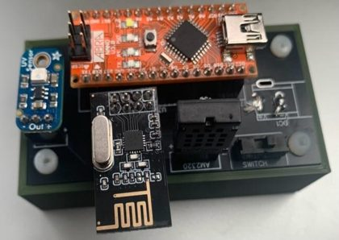
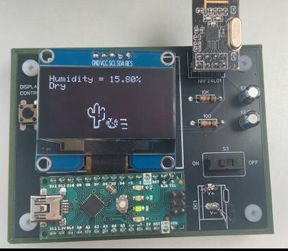
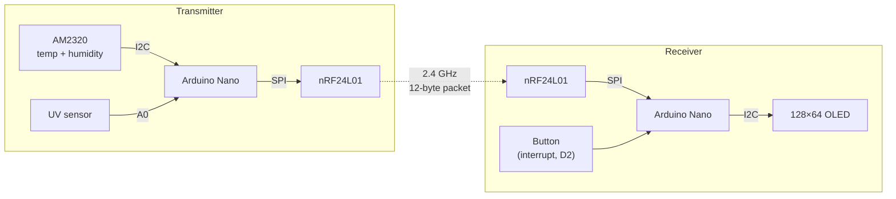
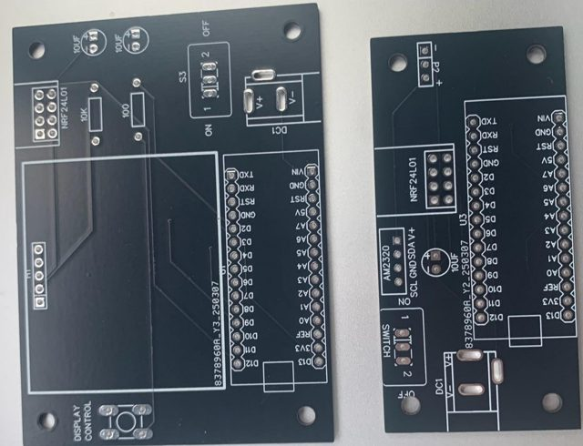
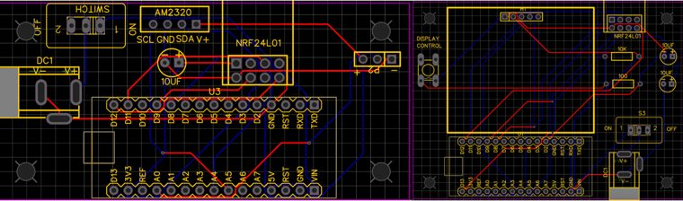
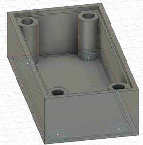

# AtmosLink: Wireless Weather Station

A two-part weather station. The **transmitter** sits outside, measures **temperature, humidity and UV**, and sends the readings over a **2.4 GHz nRF24L01 radio**. The **receiver** shows them on a 128×64 OLED with hand-drawn icons, and a button flips between screens. Both sides run on an **Arduino Nano** on a custom PCB, in a 3D-printed case with a 9 V battery.

| Transmitter (outside) | Receiver (inside) |
|:---:|:---:|
|  |  |

▶️ **[Demo video](https://youtu.be/9sG1UDuIksI)**

Built as an independent project for my Grade 11 computer engineering course at Royal St. George's College (2025).

**Highlights**
- **Wireless link** with an nRF24L01 radio over **SPI**: all three readings travel together in one 12-byte packet.
- **Sensors:** an AM2320 temperature and humidity sensor over **I2C**, and an analog UV sensor.
- **OLED interface** over I2C, with **custom bitmap icons** I drew myself and turned into hex arrays.
- **Interrupt-driven button** with a hardware debounce circuit to switch screens.
- **Two custom PCBs** made as small as possible, plus 3D-printed cases.

---

## How it works



### One packet, three readings

Both Nanos share the same `struct`, so all the readings go in a single radio packet:

```cpp
struct SensorData {
  float TEMP;   // °C, from the AM2320
  float HUM;    // %, from the AM2320
  float UV;     // UV index, from the UV sensor
};

radio.write(&data, sizeof(data));   // transmitter: send all 12 bytes at once
radio.read(&data, sizeof(data));    // receiver: unpack into the identical struct
```

The `&` passes the address of the data, so the radio library copies the actual bytes from memory into its send buffer.

### Sensors

- **Temperature and humidity:** the AM2320 talks to the Nano over I2C.
- **UV:** the UV sensor outputs a voltage that rises in a straight line with UV strength, so the code converts it with simple maths: `UV index = voltage / 0.1 V`.

### Receiver screens

A push button on interrupt pin D2 cycles through the screens with `SLIDE = (SLIDE + 1) % 3`, which counts 0 → 1 → 2 → 0. An RC debounce circuit on the button stops one press from counting twice.

| Screen | Shows |
|---|---|
| **Temperature** | A "feeling" from *Freezing* (< 10 °C) to *Very hot* (> 34 °C), with a snowflake, room or sun icon. It also tracks the highest and lowest temperature since power-on. |
| **Humidity** | *Dry* (< 20 %), *Comfortable*, *Humid* or *Very humid* (> 70 %), with cactus and rain icons |
| **UV** | The UV index, with an icon for five levels from very low to very high |

The icons started as drawings on an iPad. I turned them into pixel art, then into the hex arrays the SSD1306 OLED driver uses (`drawBitmap()`).

---

## Hardware

| Both custom PCBs (receiver left, transmitter right) |
|:---:|
|  |

| PCB layouts | 3D-printed case |
|:---:|:---:|
|  |  |

I checked both boards dozens of times before ordering, and both worked. The cases are sized to fit the PCB with just enough room for the 9 V battery.

### Parts

| Qty | Part |
|---|---|
| 2 | Arduino Nano |
| 2 | nRF24L01 radio module, with breadboard RF adapter |
| 1 | AM2320 temperature and humidity sensor |
| 1 | Adafruit analog UV sensor |
| 1 | 128×64 1.54" SSD1306 OLED (I2C) |
| 1 | Push button (with a hardware debounce circuit) |
| 3 | 10 µF capacitors |
| 1 / 1 | 10 kΩ / 100 Ω resistors |
| 2 | Custom PCBs and 3D-printed cases |
| 2 | DC power jacks, SPDT power switches and 9 V batteries |

### Pins

| Signal | Transmitter | Receiver |
|---|---|---|
| nRF24L01 CE / CSN | D9 / D8 | D9 / D8 |
| nRF24L01 SPI | D11 MOSI, D12 MISO, D13 SCK | same |
| I2C (AM2320 / OLED) | A4 SDA, A5 SCL | A4 SDA, A5 SCL (OLED at 0x3C) |
| UV sensor | A0 | – |
| Screen button | – | D2 (interrupt) |

Radio settings: address `"1Node"`, low power, 1 Mbps.

## Code

| File | Runs on |
|---|---|
| [`transmitter/transmitter.ino`](transmitter/transmitter.ino) | Outdoor sensor unit |
| [`receiver/receiver.ino`](receiver/receiver.ino) | Indoor display unit (most of the file is the bitmap icon data) |

**Libraries:** RF24 (TMRh20), Adafruit GFX, Adafruit SSD1306, Adafruit AM2320 and Adafruit Unified Sensor. All of them install through the Arduino Library Manager.

---

## What I learned

- **Wireless communication:** I started two weeks before the project with simple tests: a button on one breadboard lighting an LED on another about 100 m away, then a potentiometer dimming it. These taught me how radio pipes and addresses work. I also helped classmates get their radios working.
- **Three buses in one project:** SPI for the radio, I2C for the sensor and OLED, and analog for UV.
- **Data packets:** grouping values into a `struct` and sending the whole thing in one go.
- **Graphics on a tiny screen:** turning drawings into bitmaps.
- **Interest drives motivation:** I picked an idea I was obsessed with, started early, and finished with working PCBs and cases.
